<div align="center">
  <a href="https://hexsage.ai/">
    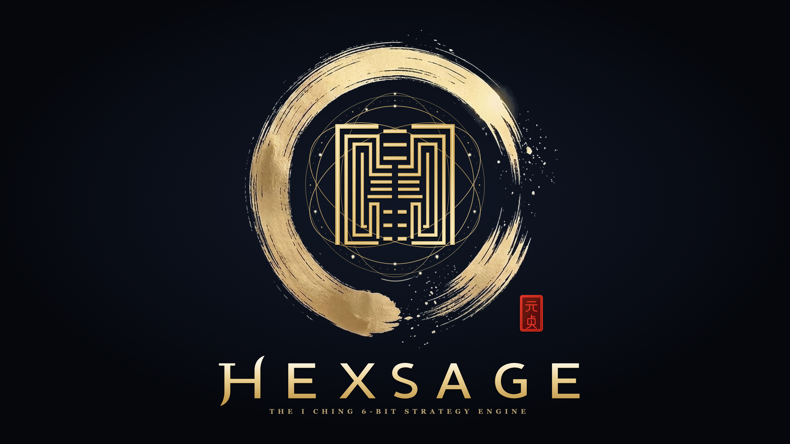
  </a>
  <br/><br/>
  <p>
    <a href="https://hexsage.ai/"></a>
    <a href="https://hexsage.ai/blog/64-hexagrams"></a>
    <a href="https://hexsage.ai/yarrow-stalks-i-ching"></a>
    <a href="https://hexsage.ai/how-to-read-changing-lines"></a>
  </p>
</div>

---

# 🌌 HexSage: 6-Bit I Ching Mathematics, Boolean Hypercube ($Q_6$) & Celestial Astrolabe Atlas

> **An open-source mathematical visualization & verification suite bridging Shao Yong's 1060 AD *Fuxi 64-Hexagram Binary Matrix*, Gottfried Wilhelm Leibniz's 1703 *Binary Arithmetic*, Jing Fang's 45 BC *8-Palace Gray-Code State Machine*, the 49-Yarrow-Stalk Asymmetric Markov Chain ($1:5:7:3$), and modern strategic decision heuristics.**

<div align="center">
  <a href="https://hexsage.ai/">
    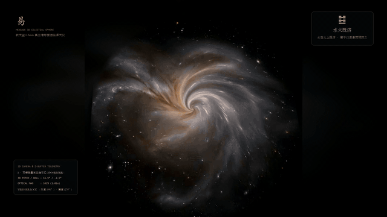
  </a>
  <a href="https://hexsage.ai/i-ching-generator">
    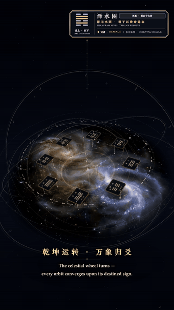
  </a>
  <p><em>Click the animations above to launch the live 3D celestial casting engine at <a href="https://hexsage.ai/"><strong>hexsage.ai</strong></a>.</em></p>
</div>

---

## 🧭 Official Interactive Sandboxes & Classical Lookup Tools (`hexsage.ai`)

| Tool / Reference Hub | Mathematical & Classical Engine | Direct Interactive URL |
| :--- | :--- | :--- |
| **1. I Ching Online (Root Sandbox)** | Astronomical True Solar Time (Equation of Time), 3-Coin & 49-Stalk Casting | [**https://hexsage.ai/**](https://hexsage.ai/) |
| **2. I Ching Interpretations & 64 Hexagrams Chart** | Complete $8 \times 8$ King Wen & Fuxi Matrix, Trigram Pairs & Line Index | [**https://hexsage.ai/blog/64-hexagrams**](https://hexsage.ai/blog/64-hexagrams) |
| **3. I Ching Generator** | Real-Time 6-Bit Hexagram Generator ($Q_6$ State Space & Binary Breakdown) | [**https://hexsage.ai/i-ching-generator**](https://hexsage.ai/i-ching-generator) |
| **4. I Ching Interpretation Tool** | Instant Wilhelm-Baynes Classical Text, Judgment, Image & Transformed Figure | [**https://hexsage.ai/iching-interpretation**](https://hexsage.ai/iching-interpretation) |
| **5. How to Read Changing Lines** | Song Dynasty Scholar Zhu Xi's (*Yixue Qimeng*) 0-to-6 Moving Line Algorithm | [**https://hexsage.ai/how-to-read-changing-lines**](https://hexsage.ai/how-to-read-changing-lines) |
| **6. Yarrow Stalks I Ching Simulator** | 50-Stalk ($49$ Active) Modulo-4 Remainder Tree & $1:5:7:3$ Probability Distribution | [**https://hexsage.ai/yarrow-stalks-i-ching**](https://hexsage.ai/yarrow-stalks-i-ching) |
| **7. I Ching Career Guidance & Game Theory** | $2 \times 2$ Subject (`Shi`) vs. Counterparty (`Ying`) Strategic Decision Matrix | [**https://hexsage.ai/i-ching-career-guidance**](https://hexsage.ai/i-ching-career-guidance) |
| **8. Yes No Oracle (6-Line Binary Verdict)** | Rapid `YES / NO / UNCLEAR` Structural Verdict Backed by Classical Lines | [**https://hexsage.ai/yes-no-oracle**](https://hexsage.ai/yes-no-oracle) |

---

## 🎬 Part I: 12-Episode 3Blue1Brown × Celestial Astrolabe Course (2K Interactive Series)

Every episode below includes an **auto-playing mathematical animation preview**, a **4K chapter poster**, a **self-contained 2K HTML5 Canvas Interactive Visualizer** (`docs/visualizers/ep01.html` – `ep12.html`), and a **live web tool** on [**hexsage.ai**](https://hexsage.ai/):

### EP.01 — The 60-Chronon Clock: Modular Arithmetic & 12 Lifecycle Stages
- **Core Mathematical Formalism**: `LCM(10, 12) = 60, Parity Lock S ≡ B (mod 2), Bi-Directional Sine Wave Thermodynamics`
- **Live Web Sandbox**: [**I Ching Online & True Solar Time Calendar Engine ↗**](https://hexsage.ai/) &nbsp;|&nbsp; [**6-Bit I Ching Generator ↗**](https://hexsage.ai/i-ching-generator) &nbsp;|&nbsp; [**Launch 2K HTML5 Canvas Visualizer ↗**](https://lcccsky.github.io/hexsage-6bit-iching-mathematics/docs/visualizers/ep01.html)

<p align="center">
  <a href="https://hexsage.ai/">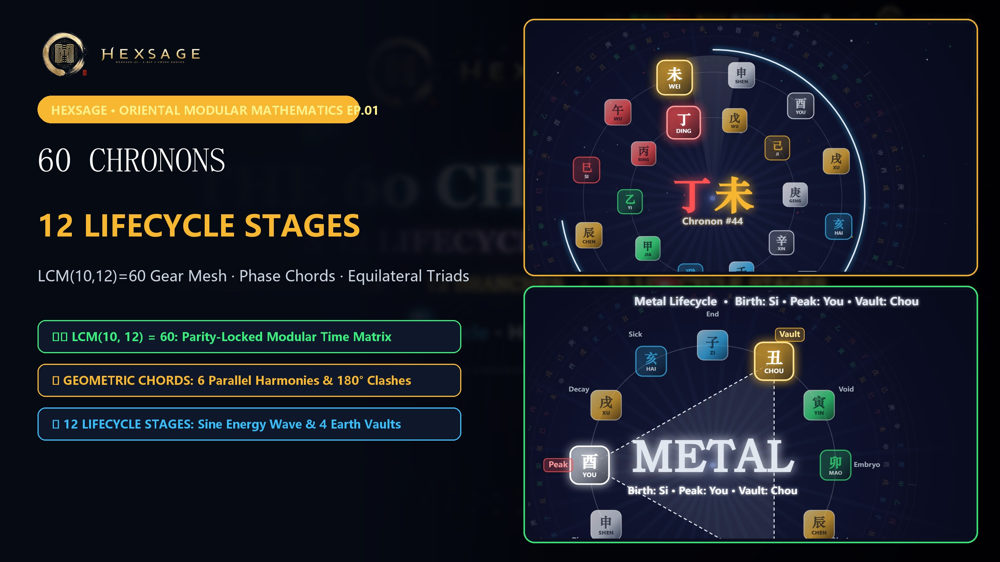</a>
  <a href="https://hexsage.ai/">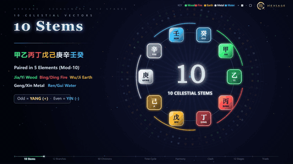</a>
</p>

### EP.02 — Jing Fang's 64 Hexagrams: 6-Bit XOR State Machine & Game Theory
- **Core Mathematical Formalism**: `Boolean Space {0,1}⁶, Bitwise XOR Masking b_next = b_curr ⊕ Mask, |Shi - Ying| = 3 Invariant`
- **Live Web Sandbox**: [**I Ching Interpretations & Complete 64 Hexagrams Chart ↗**](https://hexsage.ai/blog/64-hexagrams) &nbsp;|&nbsp; [**Interactive I Ching Hexagram Generator ↗**](https://hexsage.ai/i-ching-generator) &nbsp;|&nbsp; [**Launch 2K HTML5 Canvas Visualizer ↗**](https://lcccsky.github.io/hexsage-6bit-iching-mathematics/docs/visualizers/ep02.html)

<p align="center">
  <a href="https://hexsage.ai/blog/64-hexagrams">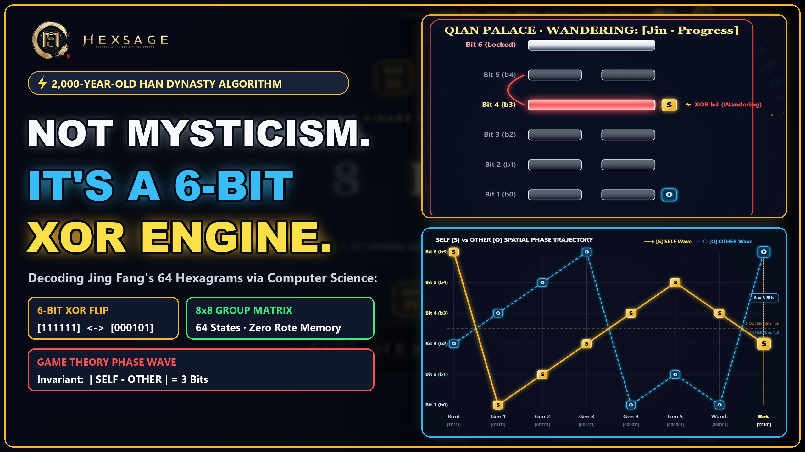</a>
  <a href="https://hexsage.ai/blog/64-hexagrams">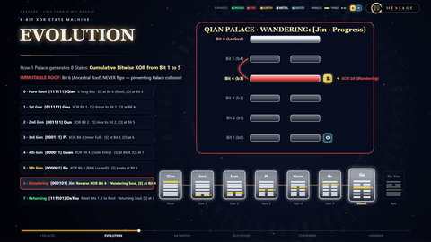</a>
</p>

### EP.03 — The 4-Force Feedback Loop: Directed Graphs on Modulo-5 (Z₅)
- **Core Mathematical Formalism**: `Digraphs on Z₅, Target (Yong-Shen), Source (+1), Threat (-1), and The Bridge Theorem (+240% Gain)`
- **Live Web Sandbox**: [**I Ching Interpretation & Line-by-Line Reading Tool ↗**](https://hexsage.ai/iching-interpretation) &nbsp;|&nbsp; [**Hexagram 43 Guai (Breakthrough) Analysis ↗**](https://hexsage.ai/blog/64-hexagrams/43-guai) &nbsp;|&nbsp; [**Launch 2K HTML5 Canvas Visualizer ↗**](https://lcccsky.github.io/hexsage-6bit-iching-mathematics/docs/visualizers/ep03.html)

<p align="center">
  <a href="https://hexsage.ai/iching-interpretation">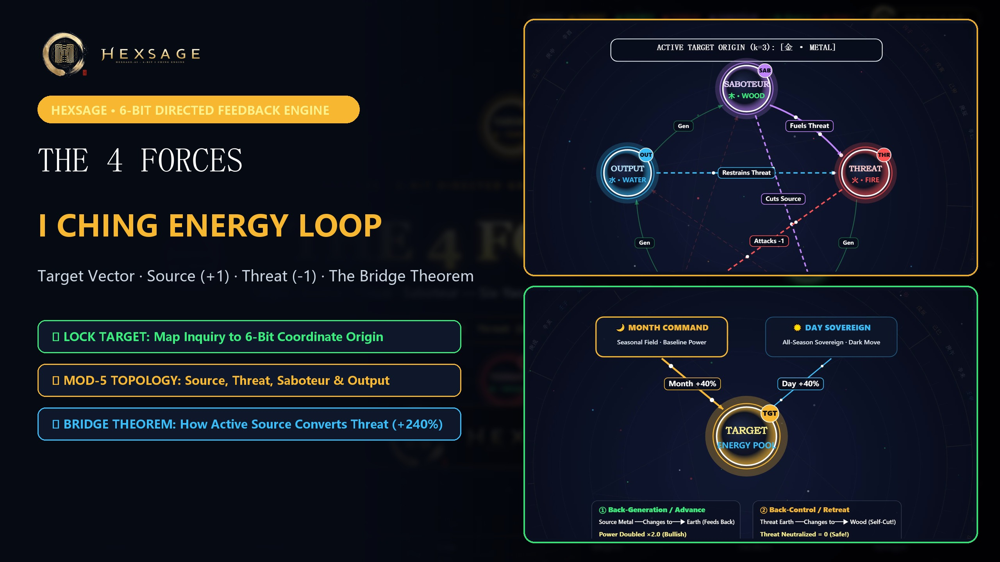</a>
  <a href="https://hexsage.ai/iching-interpretation">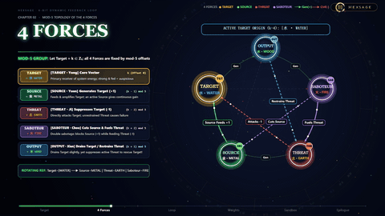</a>
</p>

### EP.04 — Dual Space-Time Gravity: Dark Move vs. Day Break Bifurcation
- **Core Mathematical Formalism**: `180° Diametric Clash Operator (b + 6 mod 12), Nonlinear State Bifurcation (+120% vs -100%)`
- **Live Web Sandbox**: [**How to Read Changing Lines & Static Line Clashes ↗**](https://hexsage.ai/how-to-read-changing-lines) &nbsp;|&nbsp; [**Cast an I Ching Reading Online ↗**](https://hexsage.ai/) &nbsp;|&nbsp; [**Launch 2K HTML5 Canvas Visualizer ↗**](https://lcccsky.github.io/hexsage-6bit-iching-mathematics/docs/visualizers/ep04.html)

<p align="center">
  <a href="https://hexsage.ai/how-to-read-changing-lines">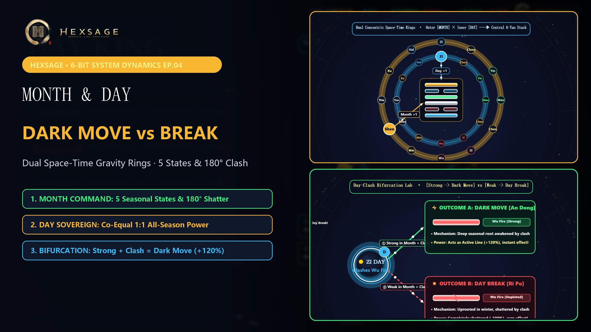</a>
  <a href="https://hexsage.ai/how-to-read-changing-lines">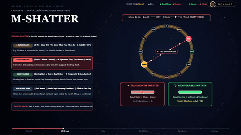</a>
</p>

### EP.05 — Hidden State Machines: Moving Lines, XOR Flips & Latent Fu-Shen
- **Core Mathematical Formalism**: `State Transition S₁ = S₀ ⊕ M, 1-to-1 Channel Isolation, Latent Variable Lookup from Palace Root`
- **Live Web Sandbox**: [**How to Read Changing Lines (0 to 6 Moving Lines Rules) ↗**](https://hexsage.ai/how-to-read-changing-lines) &nbsp;|&nbsp; [**Hexagram 33 Dun (Retreat) Line Study ↗**](https://hexsage.ai/blog/64-hexagrams/33-dun) &nbsp;|&nbsp; [**Launch 2K HTML5 Canvas Visualizer ↗**](https://lcccsky.github.io/hexsage-6bit-iching-mathematics/docs/visualizers/ep05.html)

<p align="center">
  <a href="https://hexsage.ai/how-to-read-changing-lines">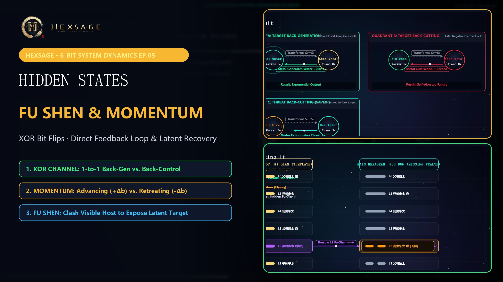</a>
  <a href="https://hexsage.ai/how-to-read-changing-lines">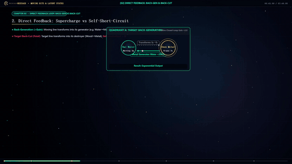</a>
</p>

### EP.06 — The 60-Chronon Null Matrix & Exact Event Timing Solver (T*)
- **Core Mathematical Formalism**: `Modulo-12 Remainder Shift (12 - 10 = 2 Null Slots), Bottleneck Resolution T* = argmin Resolve(B)`
- **Live Web Sandbox**: [**Yes No Oracle — Instant 6-Line Timing & Decision Verdict ↗**](https://hexsage.ai/yes-no-oracle) &nbsp;|&nbsp; [**Hexagram 32 Heng (Duration) Timing Guide ↗**](https://hexsage.ai/blog/64-hexagrams/32-heng) &nbsp;|&nbsp; [**Launch 2K HTML5 Canvas Visualizer ↗**](https://lcccsky.github.io/hexsage-6bit-iching-mathematics/docs/visualizers/ep06.html)

<p align="center">
  <a href="https://hexsage.ai/yes-no-oracle">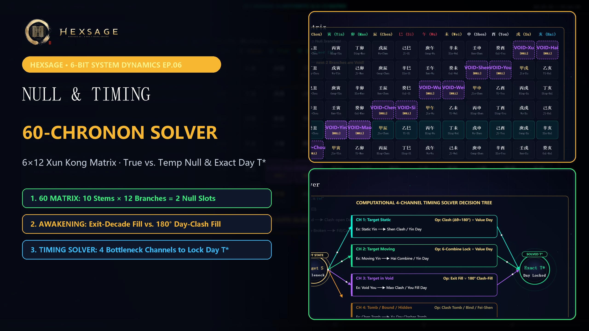</a>
  <a href="https://hexsage.ai/yes-no-oracle">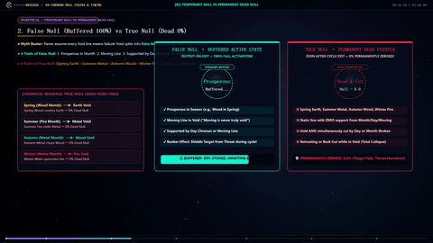</a>
</p>

### EP.07 — 1060 AD Shao Yong × 1703 Leibniz: The Fuxi 6-Bit Binary Matrix
- **Core Mathematical Formalism**: `Complete Binary Tree (2⁰ → 2⁶ = 64), 8×8 Cartesian Tensor Grid, Bitwise Complement H + H̅ = 63`
- **Live Web Sandbox**: [**64 Hexagrams Binary Matrix & I Ching Hexagram Chart ↗**](https://hexsage.ai/blog/64-hexagrams) &nbsp;|&nbsp; [**Carl Jung Synchronicity & Binary Epistemology ↗**](https://hexsage.ai/blog/i-ching-guides/carl-jung-i-ching-synchronicity) &nbsp;|&nbsp; [**Launch 2K HTML5 Canvas Visualizer ↗**](https://lcccsky.github.io/hexsage-6bit-iching-mathematics/docs/visualizers/ep07.html)

<p align="center">
  <a href="https://hexsage.ai/blog/64-hexagrams">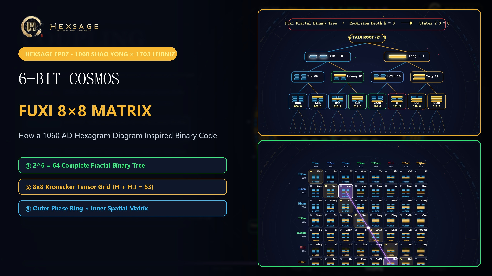</a>
  <a href="https://hexsage.ai/blog/64-hexagrams">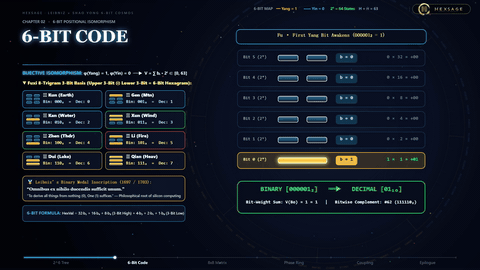</a>
</p>

### EP.08 — The M=15 Magic Square & Trigram Topology: He-Tu & Luo-Shu
- **Core Mathematical Formalism**: `Modulo-5 Cosets (C_i - S_i = 5), 3×3 Magic Square Constant M=15, Dihedral Group D₄ Symmetry Breaking`
- **Live Web Sandbox**: [**Online I Ching Trigram & Hexagram Generator ↗**](https://hexsage.ai/i-ching-generator) &nbsp;|&nbsp; [**Hexagram 11 Tai (Harmony) Structural Balance ↗**](https://hexsage.ai/blog/64-hexagrams/11-tai) &nbsp;|&nbsp; [**Launch 2K HTML5 Canvas Visualizer ↗**](https://lcccsky.github.io/hexsage-6bit-iching-mathematics/docs/visualizers/ep08.html)

<p align="center">
  <a href="https://hexsage.ai/i-ching-generator">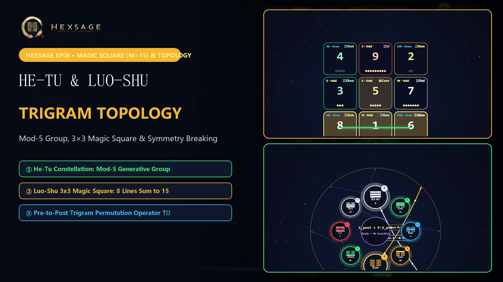</a>
  <a href="https://hexsage.ai/i-ching-generator">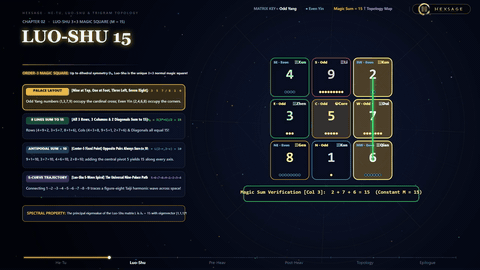</a>
</p>

### EP.09 — The 12 Tidal Hexagrams & 24 Solar Terms: 6-Bit Shift Register
- **Core Mathematical Formalism**: `Circular Shift Register Hamming Weight E(k) = 3 + 3·sin((k-2)π/6), Thermal Phase Lag Δφ ≈ 30°`
- **Live Web Sandbox**: [**Hexagram 24 Fu (Return) Inflection Point Analysis ↗**](https://hexsage.ai/blog/64-hexagrams/24-fu) &nbsp;|&nbsp; [**All 64 I Ching Hexagrams Explained ↗**](https://hexsage.ai/blog/64-hexagrams) &nbsp;|&nbsp; [**Launch 2K HTML5 Canvas Visualizer ↗**](https://lcccsky.github.io/hexsage-6bit-iching-mathematics/docs/visualizers/ep09.html)

<p align="center">
  <a href="https://hexsage.ai/blog/64-hexagrams/24-fu">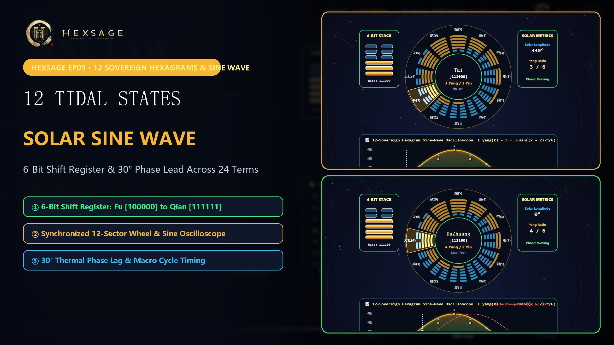</a>
  <a href="https://hexsage.ai/blog/64-hexagrams/24-fu">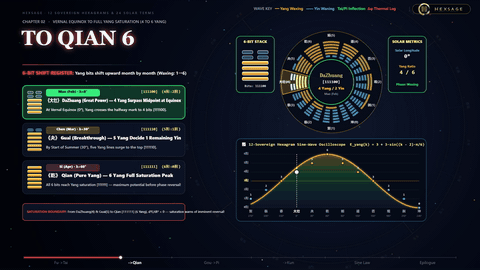</a>
</p>

### EP.10 — Why 49 Yarrow Stalks Make Yang Move 3× More Than Yin (1:5:7:3 Proof)
- **Core Mathematical Formalism**: `Modulo-4 Remainder Tree: P(6)=1/16, P(7)=5/16, P(8)=7/16, P(9)=3/16; Shannon Entropy 1.754 vs 1.811 bits`
- **Live Web Sandbox**: [**Yarrow Stalks I Ching — 49-Stalk 18-Change Interactive Simulator ↗**](https://hexsage.ai/yarrow-stalks-i-ching) &nbsp;|&nbsp; [**3-Coin vs Yarrow Stalks I Ching Generator ↗**](https://hexsage.ai/i-ching-generator) &nbsp;|&nbsp; [**Launch 2K HTML5 Canvas Visualizer ↗**](https://lcccsky.github.io/hexsage-6bit-iching-mathematics/docs/visualizers/ep10.html)

<p align="center">
  <a href="https://hexsage.ai/yarrow-stalks-i-ching">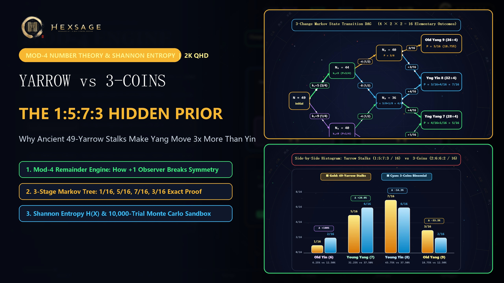</a>
  <a href="https://hexsage.ai/yarrow-stalks-i-ching">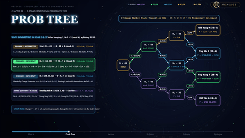</a>
</p>

### EP.11 — 6 Stages of Leverage: Hexagram #1 Qian [111111] & Kelly Criterion
- **Core Mathematical Formalism**: `S-Curve Logistic Growth, Kelly Position Sizing f* = (bp - q)/b, Decentralized Protocol (Yong Jiu)`
- **Live Web Sandbox**: [**Hexagram 1 Qian (The Creative) — All 6 Lines & Strategic Guide ↗**](https://hexsage.ai/blog/64-hexagrams/01-qian) &nbsp;|&nbsp; [**I Ching Career & Capital Allocation Sandbox ↗**](https://hexsage.ai/i-ching-career-guidance) &nbsp;|&nbsp; [**Launch 2K HTML5 Canvas Visualizer ↗**](https://lcccsky.github.io/hexsage-6bit-iching-mathematics/docs/visualizers/ep11.html)

<p align="center">
  <a href="https://hexsage.ai/blog/64-hexagrams/01-qian">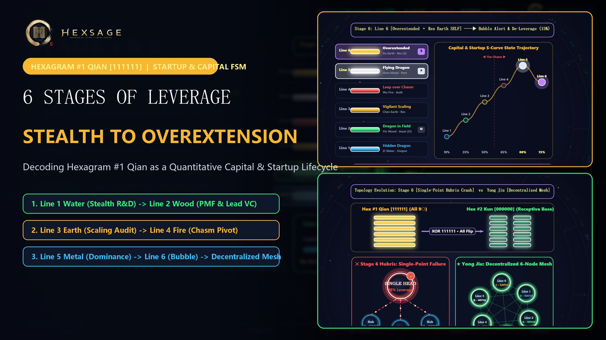</a>
  <a href="https://hexsage.ai/blog/64-hexagrams/01-qian">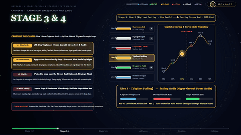</a>
</p>

### EP.12 — Oriental Game Theory: Six-Yao Matrix for Forensic Cashflow Audits
- **Core Mathematical Formalism**: `2×2 SELF [Shi] vs OTHER [Ying] Payoff Matrix, Cashflow Differential d(Cash)/dt = α·Output - β·Peer`
- **Live Web Sandbox**: [**I Ching Career Guidance & Business Decision Matrix ↗**](https://hexsage.ai/i-ching-career-guidance) &nbsp;|&nbsp; [**Interpret Your Hexagram & Moving Lines ↗**](https://hexsage.ai/iching-interpretation) &nbsp;|&nbsp; [**Launch 2K HTML5 Canvas Visualizer ↗**](https://lcccsky.github.io/hexsage-6bit-iching-mathematics/docs/visualizers/ep12.html)

<p align="center">
  <a href="https://hexsage.ai/i-ching-career-guidance">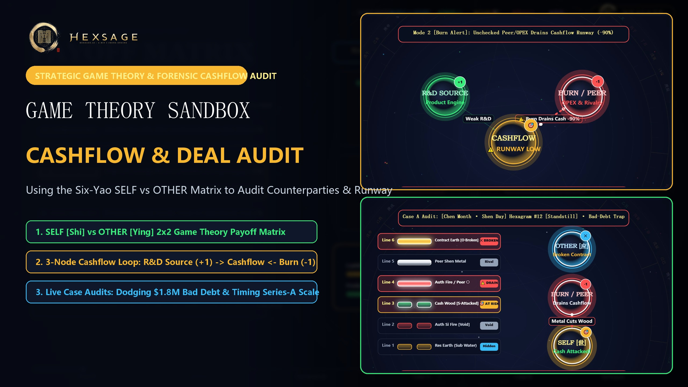</a>
  <a href="https://hexsage.ai/i-ching-career-guidance">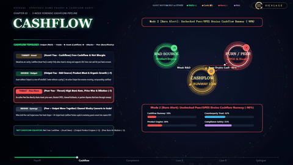</a>
</p>

---

## 📐 Part II: 10-Volume "Oriental Metaphysics × Modern Mathematics" Visual Atlas & CheatSheets

A 10-part visual monograph mapping classical Chinese cosmological structures onto **Linear Algebra, Group Theory, Graph Theory, Coding Theory, Harmonic Analysis, and Markov Chains**. Click any CheatSheet or animation to explore the corresponding interactive model on [**hexsage.ai**](https://hexsage.ai/):

| Vol | Mathematical Topic & Governing Equation | Animated Preview | High-Res Reference CheatSheet | Live Interactive Sandbox |
| :---: | :--- | :---: | :---: | :--- |
| **VOL.01** | **Wuxing Five Elements: Z₅ Circulant Permutation Matrix**<br/>`M_gen² = M_ctrl ∧ M_ctrl² = M_genᵀ` | [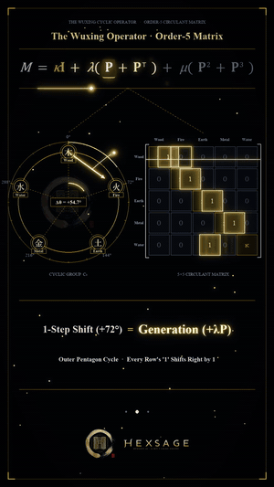](https://hexsage.ai/iching-interpretation) | [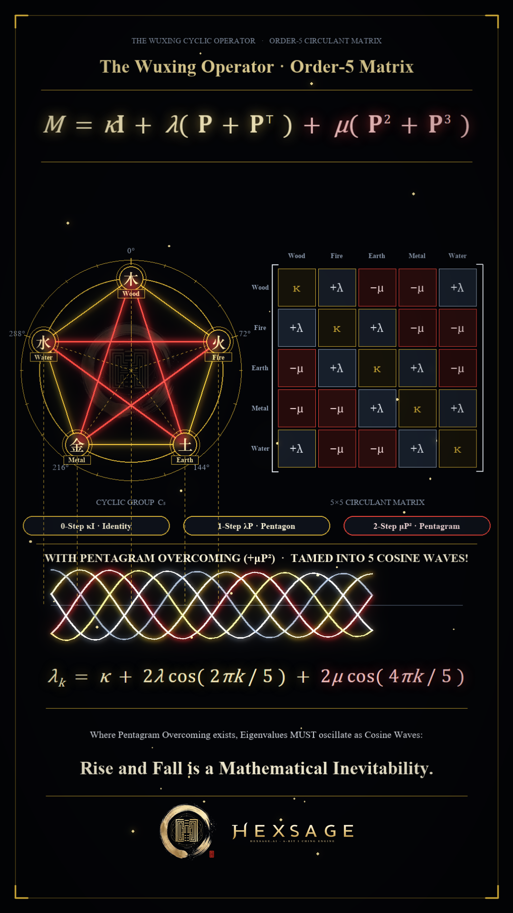](https://hexsage.ai/iching-interpretation) | [**I Ching Interpretation Tool ↗**](https://hexsage.ai/iching-interpretation) |
| **VOL.02** | **60-Jiazi Calendar: Modular Congruence & Parity Lock**<br/>`t ≡ a (mod 10) ∧ t ≡ b (mod 12) ⇒ gcd(10,12) = 2` | [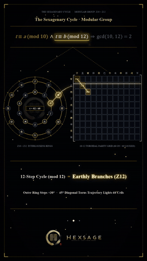](https://hexsage.ai/) | [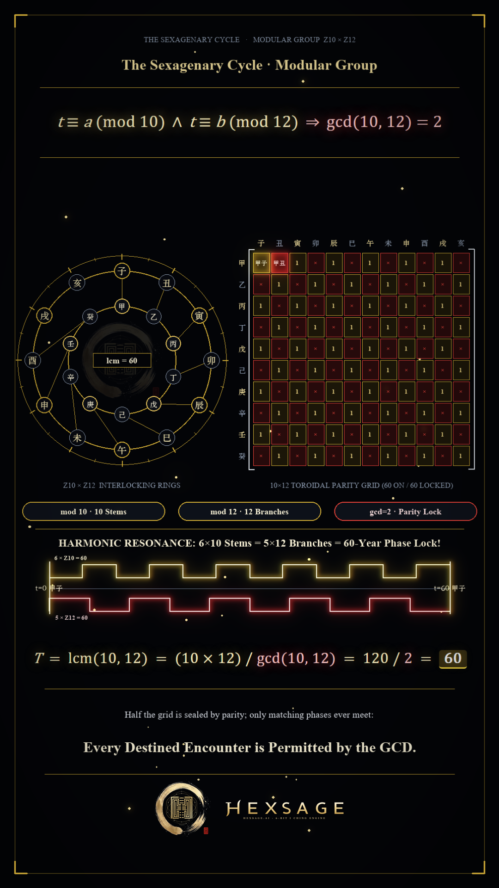](https://hexsage.ai/) | [**I Ching Online True Solar Time ↗**](https://hexsage.ai/) |
| **VOL.03** | **64 Hexagrams: 6D Boolean Hypercube (Q₆) & Hamming Distance**<br/>`H₆ = (Z₂)⁶, d_H(u,v) = ∑ |u_i ⊕ v_i|` | [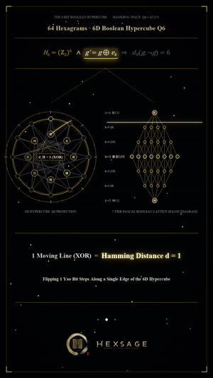](https://hexsage.ai/blog/64-hexagrams) | [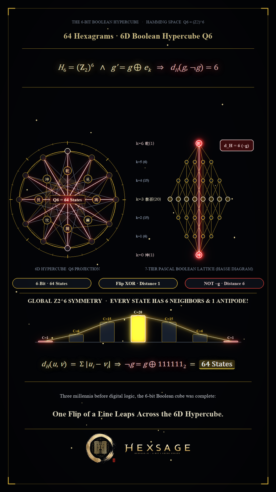](https://hexsage.ai/blog/64-hexagrams) | [**Complete 64 I Ching Hexagrams Chart ↗**](https://hexsage.ai/blog/64-hexagrams) |
| **VOL.04** | **Jing Fang's 8 Palaces: Gray Code Hamiltonian Path & Cosets**<br/>`g_{k+1} = g_k ⊕ e_σ(k), σ = (1,2,3,4,5,4,123)` | [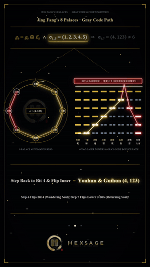](https://hexsage.ai/blog/64-hexagrams) | [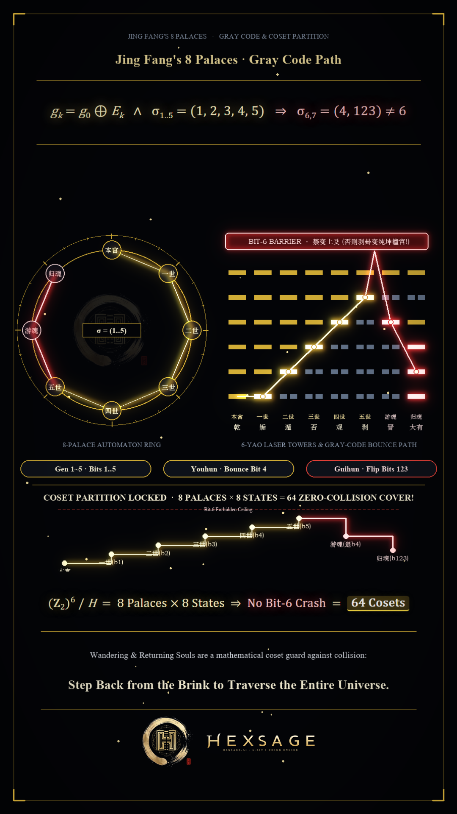](https://hexsage.ai/blog/64-hexagrams) | [**I Ching Interpretations & 8 Palaces ↗**](https://hexsage.ai/blog/64-hexagrams) |
| **VOL.05** | **Shao Yong Binary Tree: Walsh-Hadamard Quantum Gate Matrix**<br/>`H_{2^n} = H₂^{⊗n}, C(6,3) = 20 Balanced States` | [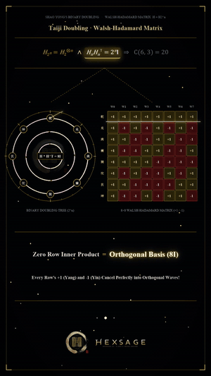](https://hexsage.ai/i-ching-generator) | [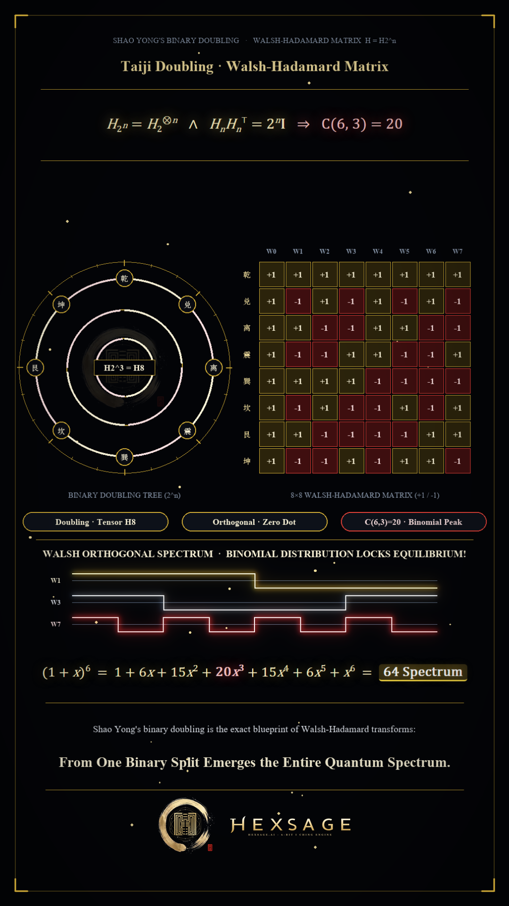](https://hexsage.ai/i-ching-generator) | [**I Ching Generator & Binary Tree ↗**](https://hexsage.ai/i-ching-generator) |
| **VOL.06** | **Lo Shu 3×3 Magic Square: Eigenvalues & D₄ Dihedral Group**<br/>`L·1 = 15·1, λ ∈ {15, +2√6, -2√6}` | [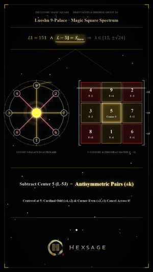](https://hexsage.ai/i-ching-career-guidance) | [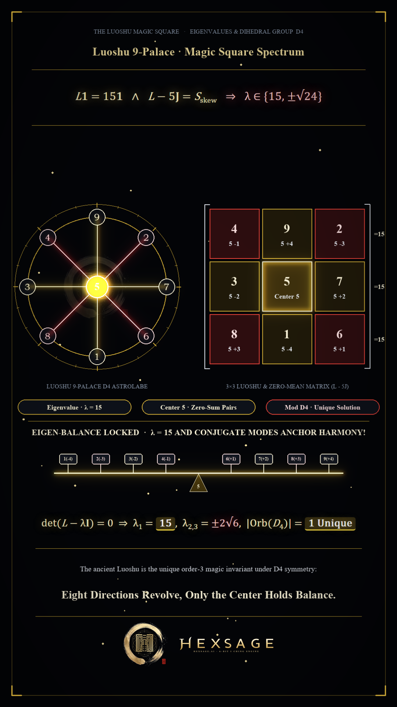](https://hexsage.ai/i-ching-career-guidance) | [**I Ching Strategic Decision Matrix ↗**](https://hexsage.ai/i-ching-career-guidance) |
| **VOL.07** | **60-Jiazi Nayin Acoustics: Quotient Group Homomorphism**<br/>`φ: Z₆₀ → Z₃₀ ↠ Z₅ Surjective Folding` | [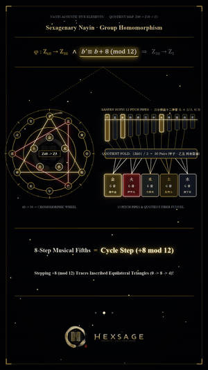](https://hexsage.ai/iching-interpretation) | [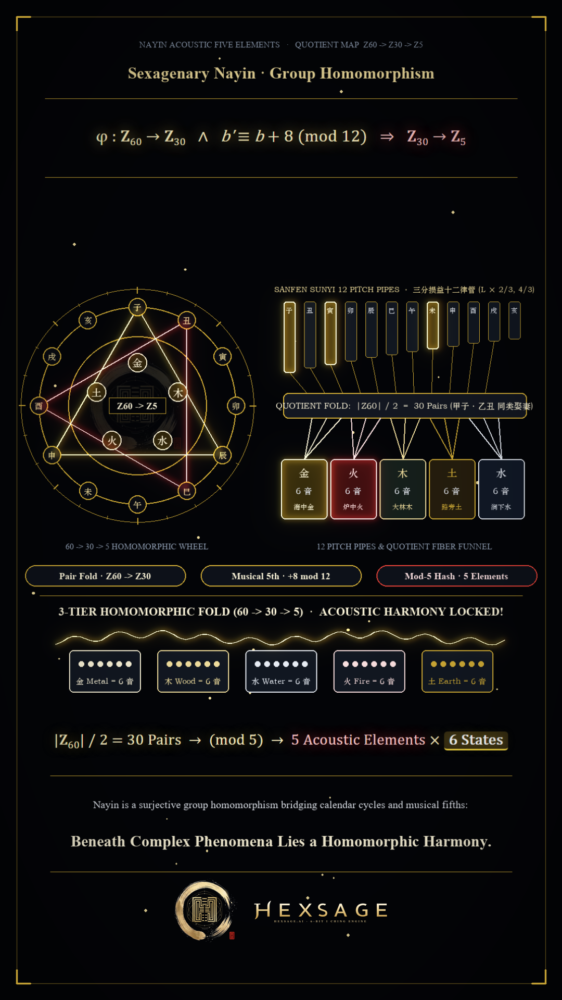](https://hexsage.ai/iching-interpretation) | [**Classical Hexagram Interpretation ↗**](https://hexsage.ai/iching-interpretation) |
| **VOL.08** | **50 Yarrow Stalks: Asymmetric Markov Chain (1:5:7:3 Prior)**<br/>`P(6)=1/16, P(7)=5/16, P(8)=7/16, P(9)=3/16` | [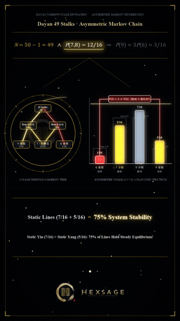](https://hexsage.ai/yarrow-stalks-i-ching) | [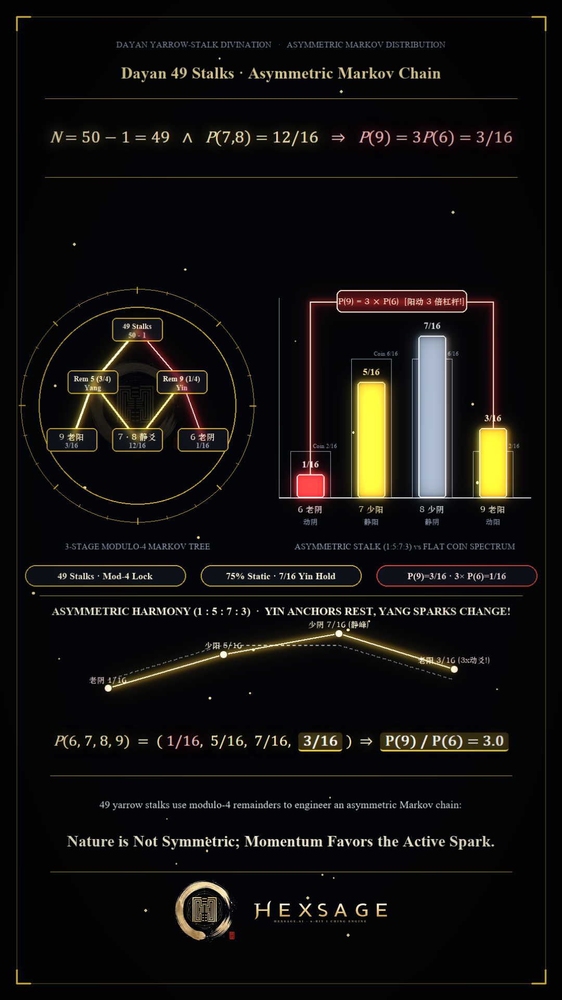](https://hexsage.ai/yarrow-stalks-i-ching) | [**Yarrow Stalks I Ching Simulator ↗**](https://hexsage.ai/yarrow-stalks-i-ching) |
| **VOL.09** | **12 Earthly Branches: Dihedral Group D₁₂ Rotations & Reflections**<br/>`Clash(b) ≡ b + 6 (mod 12), Harmony(b) ≡ 1 - b (mod 12)` | [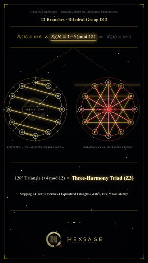](https://hexsage.ai/how-to-read-changing-lines) | [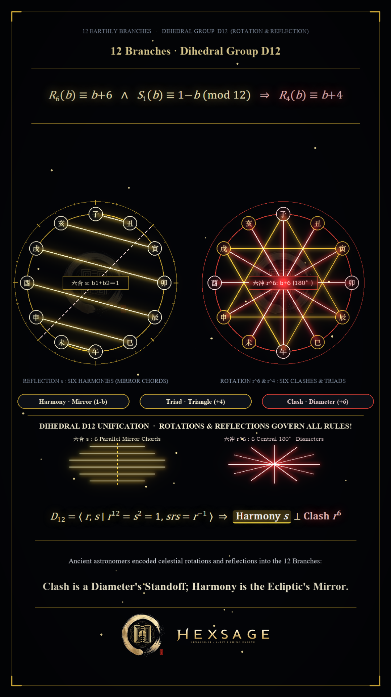](https://hexsage.ai/how-to-read-changing-lines) | [**How to Read Changing Lines ↗**](https://hexsage.ai/how-to-read-changing-lines) |
| **VOL.10** | **Fuxi Circle & Square Diagram: 64-Order Kronecker Tensor Product**<br/>`G₆₄ = v_upper ⊗ v_lowerᵀ ∈ R^{8×8}` | [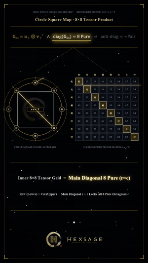](https://hexsage.ai/yes-no-oracle) | [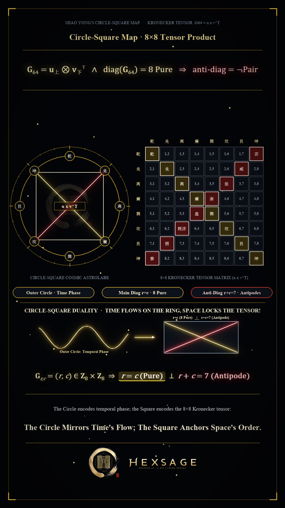](https://hexsage.ai/yes-no-oracle) | [**Yes No Oracle Binary Verdict ↗**](https://hexsage.ai/yes-no-oracle) |

---

## 🐍 Part III: Open-Source Python Mathematical Verification Suite (`src/hexsage_math.py`)

Run `python src/hexsage_math.py` (zero external dependencies required) to mathematically verify the key theorems demonstrated in our video series:

### Theorem 1: Why the 49-Yarrow-Stalk Algorithm Produces an Asymmetric $1:5:7:3$ Prior

Unlike the 3-coin toss method—which follows a symmetric binomial distribution $P(6,7,8,9) = \{2/16, 6/16, 6/16, 2/16\}$—setting aside 1 observer stalk (`Gua Yi`, $50 - 1 = 49$) breaks modulo-4 symmetry on the first division ($P(\text{remove } 5) = 3/4$ vs. $P(\text{remove } 9) = 1/4$). Across three successive transformations, the 16 equiprobable elementary outcomes partition into:

$$P(6\text{ Old Yin}) = \frac{1}{16}, \quad P(7\text{ Young Yang}) = \frac{5}{16}, \quad P(8\text{ Young Yin}) = \frac{7}{16}, \quad P(9\text{ Old Yang}) = \frac{3}{16}$$

- **Parity Conservation**: Total Yang probability $P(7)+P(9) = 8/16 = 50\%$ equals Total Yin probability $P(6)+P(8) = 8/16 = 50\%$.
- **Dynamic Asymmetry**: Active moving Yang ($P(9)=3/16$) is **3× more likely** than active moving Yin ($P(6)=1/16$).
- **Interactive Web Proof**: Test 18-step stalk division vs. 3-coin binomial convergence at [**https://hexsage.ai/yarrow-stalks-i-ching**](https://hexsage.ai/yarrow-stalks-i-ching).

### Theorem 2: $Q_6$ Boolean Hypercube Bitwise XOR State Transitions & Zhu Xi's Moving-Line Hierarchy

Each hexagram is a 6-bit binary vector $S_t \in \{0,1\}^6$. When a set of lines $M \in \{0,1\}^6$ becomes active (`moving lines`), the system transitions via bitwise XOR across a Hamming distance $d_H = \lVert M \rVert_1$:

$$S_{t+1} = S_t \oplus M \in (\mathbb{Z}_2)^6$$

```python
from src.hexsage_math import prove_yarrow_vs_coins_entropy, transition_hexagram, solve_changing_lines_rule

# 1. Verify the 1:5:7:3 Yarrow Stalk Markov distribution & Shannon Entropy
print(prove_yarrow_vs_coins_entropy())
# -> {'yarrow_stalk_distribution_16ths': {6: 1, 7: 5, 8: 7, 9: 3}, 'yarrow_shannon_entropy_bits': 1.754, ...}

# 2. Compute Q_6 Hypercube XOR transition for Hexagram #1 Qian (111111) with Moving Lines 1 & 4
print(transition_hexagram('111111', [1, 4]))
# -> {'primary_bits': '111111', 'perturbation_mask': '100100', 'transformed_bits': '011011', 'hamming_distance': 2}

# 3. Resolve multi-line conflicts using Zhu Xi's (1186 AD) 0-to-6 Moving Line Algorithm
print(solve_changing_lines_rule([1, 2, 4, 5]))
# -> {'moving_count': '4', 'primary_focus': 'Transformed Hexagram Static Lines #3 & #6 (Lower Static Line #3 takes precedence)'}
```

---

## 📊 Part IV: Complete 64 I Ching Hexagrams (`000000` – `111111`) Canonical Reference Matrix

Browse the complete index on our [**I Ching Hexagrams Chart (`hexsage.ai/blog/64-hexagrams`)**](https://hexsage.ai/blog/64-hexagrams), or click any hexagram below to read its classical Judgment, Image, 6 Line Statements, and structural relationships:

| King Wen # | Binary ($Q_6$) | Hexagram Name | Classical Title | Strategic System Archetype | Classical Text & Line Guide | Moving-Line Interpreter |
| :---: | :---: | :--- | :--- | :--- | :---: | :---: |
| **01** | `111111` | [**Hexagram 1: Qian**](https://hexsage.ai/blog/64-hexagrams/01-qian) | *The Creative* | Pure Yang Initiative & Sovereign Momentum | [Full Guide ↗](https://hexsage.ai/blog/64-hexagrams/01-qian) | [Interpret Lines ↗](https://hexsage.ai/iching-interpretation/1) |
| **02** | `000000` | [**Hexagram 2: Kun**](https://hexsage.ai/blog/64-hexagrams/02-kun) | *The Receptive* | Receptive Capacity & Adaptive Infrastructure | [Full Guide ↗](https://hexsage.ai/blog/64-hexagrams/02-kun) | [Interpret Lines ↗](https://hexsage.ai/iching-interpretation/2) |
| **03** | `100010` | [**Hexagram 3: Zhun**](https://hexsage.ai/blog/64-hexagrams/03-zhun) | *Difficulty at the Beginning* | Initial Entropy & Foundational Incubation | [Full Guide ↗](https://hexsage.ai/blog/64-hexagrams/03-zhun) | [Interpret Lines ↗](https://hexsage.ai/iching-interpretation/3) |
| **04** | `010001` | [**Hexagram 4: Meng**](https://hexsage.ai/blog/64-hexagrams/04-meng) | *Youthful Folly* | Cognitive Calibration & Disciplined Inquiry | [Full Guide ↗](https://hexsage.ai/blog/64-hexagrams/04-meng) | [Interpret Lines ↗](https://hexsage.ai/iching-interpretation/4) |
| **05** | `111010` | [**Hexagram 5: Xu**](https://hexsage.ai/blog/64-hexagrams/05-xu) | *Waiting (Nourishment)* | Strategic Patience Before Critical Threshold | [Full Guide ↗](https://hexsage.ai/blog/64-hexagrams/05-xu) | [Interpret Lines ↗](https://hexsage.ai/iching-interpretation/5) |
| **06** | `010111` | [**Hexagram 6: Song**](https://hexsage.ai/blog/64-hexagrams/06-song) | *Conflict* | Asymmetric Friction & Boundary Negotiation | [Full Guide ↗](https://hexsage.ai/blog/64-hexagrams/06-song) | [Interpret Lines ↗](https://hexsage.ai/iching-interpretation/6) |
| **07** | `010000` | [**Hexagram 7: Shi**](https://hexsage.ai/blog/64-hexagrams/07-shi) | *The Army* | Disciplined Resource Mobilization | [Full Guide ↗](https://hexsage.ai/blog/64-hexagrams/07-shi) | [Interpret Lines ↗](https://hexsage.ai/iching-interpretation/7) |
| **08** | `000010` | [**Hexagram 8: Bi**](https://hexsage.ai/blog/64-hexagrams/08-bi) | *Holding Together* | Coalition Alignment & Trust Gravity | [Full Guide ↗](https://hexsage.ai/blog/64-hexagrams/08-bi) | [Interpret Lines ↗](https://hexsage.ai/iching-interpretation/8) |
| **09** | `111011` | [**Hexagram 9: Xiao Xu**](https://hexsage.ai/blog/64-hexagrams/09-xiaoxu) | *Small Taming* | Incremental Leverage & Micro-Accumulation | [Full Guide ↗](https://hexsage.ai/blog/64-hexagrams/09-xiaoxu) | [Interpret Lines ↗](https://hexsage.ai/iching-interpretation/9) |
| **10** | `110111` | [**Hexagram 10: Lv**](https://hexsage.ai/blog/64-hexagrams/10-lv) | *Treading (Conduct)* | High-Risk Navigation & Protocol Precision | [Full Guide ↗](https://hexsage.ai/blog/64-hexagrams/10-lv) | [Interpret Lines ↗](https://hexsage.ai/iching-interpretation/10) |
| **11** | `111000` | [**Hexagram 11: Tai**](https://hexsage.ai/blog/64-hexagrams/11-tai) | *Peace (Harmony)* | Optimal Flow & Cross-System Synergy | [Full Guide ↗](https://hexsage.ai/blog/64-hexagrams/11-tai) | [Interpret Lines ↗](https://hexsage.ai/iching-interpretation/11) |
| **12** | `000111` | [**Hexagram 12: Pi**](https://hexsage.ai/blog/64-hexagrams/12-pi) | *Standstill (Stagnation)* | Systemic Decoupling & Defensive Preservation | [Full Guide ↗](https://hexsage.ai/blog/64-hexagrams/12-pi) | [Interpret Lines ↗](https://hexsage.ai/iching-interpretation/12) |
| **13** | `101111` | [**Hexagram 13: Tong Ren**](https://hexsage.ai/blog/64-hexagrams/13-tongren) | *Fellowship with Men* | Open-Network Collaboration & Shared Vision | [Full Guide ↗](https://hexsage.ai/blog/64-hexagrams/13-tongren) | [Interpret Lines ↗](https://hexsage.ai/iching-interpretation/13) |
| **14** | `111101` | [**Hexagram 14: Da You**](https://hexsage.ai/blog/64-hexagrams/14-dayou) | *Possession in Great Measure* | Abundant Capital & High-Visibility Stewardship | [Full Guide ↗](https://hexsage.ai/blog/64-hexagrams/14-dayou) | [Interpret Lines ↗](https://hexsage.ai/iching-interpretation/14) |
| **15** | `001000` | [**Hexagram 15: Qian (Modesty)**](https://hexsage.ai/blog/64-hexagrams/15-qian) | *Modesty* | Structural Equilibrium & Low-Ego Leverage | [Full Guide ↗](https://hexsage.ai/blog/64-hexagrams/15-qian) | [Interpret Lines ↗](https://hexsage.ai/iching-interpretation/15) |
| **16** | `000100` | [**Hexagram 16: Yu**](https://hexsage.ai/blog/64-hexagrams/16-yu) | *Enthusiasm* | Momentum Preparation & Early-Warning Readiness | [Full Guide ↗](https://hexsage.ai/blog/64-hexagrams/16-yu) | [Interpret Lines ↗](https://hexsage.ai/iching-interpretation/16) |
| **17** | `100110` | [**Hexagram 17: Sui**](https://hexsage.ai/blog/64-hexagrams/17-sui) | *Following* | Adaptive Flow & Context-Driven Alignment | [Full Guide ↗](https://hexsage.ai/blog/64-hexagrams/17-sui) | [Interpret Lines ↗](https://hexsage.ai/iching-interpretation/17) |
| **18** | `011001` | [**Hexagram 18: Gu**](https://hexsage.ai/blog/64-hexagrams/18-gu) | *Work on What Has Been Spoiled* | Technical Debt Remediation & Root-Cause Audit | [Full Guide ↗](https://hexsage.ai/blog/64-hexagrams/18-gu) | [Interpret Lines ↗](https://hexsage.ai/iching-interpretation/18) |
| **19** | `110000` | [**Hexagram 19: Lin**](https://hexsage.ai/blog/64-hexagrams/19-lin) | *Approach* | Ascending Window & Proactive Supervision | [Full Guide ↗](https://hexsage.ai/blog/64-hexagrams/19-lin) | [Interpret Lines ↗](https://hexsage.ai/iching-interpretation/19) |
| **20** | `000011` | [**Hexagram 20: Guan**](https://hexsage.ai/blog/64-hexagrams/20-guan) | *Contemplation (View)* | Macro Observation Before Commitment | [Full Guide ↗](https://hexsage.ai/blog/64-hexagrams/20-guan) | [Interpret Lines ↗](https://hexsage.ai/iching-interpretation/20) |
| **21** | `100101` | [**Hexagram 21: Shi Ke**](https://hexsage.ai/blog/64-hexagrams/21-shike) | *Biting Through* | Decisive Enforcement & Obstacle Removal | [Full Guide ↗](https://hexsage.ai/blog/64-hexagrams/21-shike) | [Interpret Lines ↗](https://hexsage.ai/iching-interpretation/21) |
| **22** | `101001` | [**Hexagram 22: Bi (Grace)**](https://hexsage.ai/blog/64-hexagrams/22-bi) | *Grace* | Aesthetic Signal Clarity & Form Optimization | [Full Guide ↗](https://hexsage.ai/blog/64-hexagrams/22-bi) | [Interpret Lines ↗](https://hexsage.ai/iching-interpretation/22) |
| **23** | `000001` | [**Hexagram 23: Bo**](https://hexsage.ai/blog/64-hexagrams/23-bo) | *Splitting Apart* | Structural Erosion & Core Asset Conservation | [Full Guide ↗](https://hexsage.ai/blog/64-hexagrams/23-bo) | [Interpret Lines ↗](https://hexsage.ai/iching-interpretation/23) |
| **24** | `100000` | [**Hexagram 24: Fu**](https://hexsage.ai/blog/64-hexagrams/24-fu) | *Return (The Turning Point)* | Inflection Point & First-Principle Renewal | [Full Guide ↗](https://hexsage.ai/blog/64-hexagrams/24-fu) | [Interpret Lines ↗](https://hexsage.ai/iching-interpretation/24) |
| **25** | `100111` | [**Hexagram 25: Wu Wang**](https://hexsage.ai/blog/64-hexagrams/25-wuwang) | *Innocence (The Unexpected)* | Non-Entangled Action & Stochastic Resilience | [Full Guide ↗](https://hexsage.ai/blog/64-hexagrams/25-wuwang) | [Interpret Lines ↗](https://hexsage.ai/iching-interpretation/25) |
| **26** | `111001` | [**Hexagram 26: Da Xu**](https://hexsage.ai/blog/64-hexagrams/26-daxu) | *Great Taming* | Deep Reserve Compounding & Institutional Memory | [Full Guide ↗](https://hexsage.ai/blog/64-hexagrams/26-daxu) | [Interpret Lines ↗](https://hexsage.ai/iching-interpretation/26) |
| **27** | `100001` | [**Hexagram 27: Yi (Nourishment)**](https://hexsage.ai/blog/64-hexagrams/27-yi) | *The Corners of the Mouth* | Input/Output Hygiene & Information Diet | [Full Guide ↗](https://hexsage.ai/blog/64-hexagrams/27-yi) | [Interpret Lines ↗](https://hexsage.ai/iching-interpretation/27) |
| **28** | `011110` | [**Hexagram 28: Da Guo**](https://hexsage.ai/blog/64-hexagrams/28-daguo) | *Preponderance of the Great* | Structural Overload & High-Stakes Transition | [Full Guide ↗](https://hexsage.ai/blog/64-hexagrams/28-daguo) | [Interpret Lines ↗](https://hexsage.ai/iching-interpretation/28) |
| **29** | `010010` | [**Hexagram 29: Kan**](https://hexsage.ai/blog/64-hexagrams/29-kan) | *The Abysmal (Water)* | Cascading Uncertainty & Core Integrity | [Full Guide ↗](https://hexsage.ai/blog/64-hexagrams/29-kan) | [Interpret Lines ↗](https://hexsage.ai/iching-interpretation/29) |
| **30** | `101101` | [**Hexagram 30: Li**](https://hexsage.ai/blog/64-hexagrams/30-li) | *The Clinging (Fire)* | Lucid Perception & Network Illumination | [Full Guide ↗](https://hexsage.ai/blog/64-hexagrams/30-li) | [Interpret Lines ↗](https://hexsage.ai/iching-interpretation/30) |
| **31** | `001110` | [**Hexagram 31: Xian**](https://hexsage.ai/blog/64-hexagrams/31-xian) | *Influence (Mutual Attraction)* | Mutual Resonance & Unforced Alignment | [Full Guide ↗](https://hexsage.ai/blog/64-hexagrams/31-xian) | [Interpret Lines ↗](https://hexsage.ai/iching-interpretation/31) |
| **32** | `011100` | [**Hexagram 32: Heng**](https://hexsage.ai/blog/64-hexagrams/32-heng) | *Duration* | Dynamic Stability & Long-Horizon Compounding | [Full Guide ↗](https://hexsage.ai/blog/64-hexagrams/32-heng) | [Interpret Lines ↗](https://hexsage.ai/iching-interpretation/32) |
| **33** | `001111` | [**Hexagram 33: Dun**](https://hexsage.ai/blog/64-hexagrams/33-dun) | *Retreat* | Tactical De-Escalation & Timing the Exit | [Full Guide ↗](https://hexsage.ai/blog/64-hexagrams/33-dun) | [Interpret Lines ↗](https://hexsage.ai/iching-interpretation/33) |
| **34** | `111100` | [**Hexagram 34: Da Zhuang**](https://hexsage.ai/blog/64-hexagrams/34-dazhuang) | *The Power of the Great* | Peak Force Restraint & Rule-Bound Power | [Full Guide ↗](https://hexsage.ai/blog/64-hexagrams/34-dazhuang) | [Interpret Lines ↗](https://hexsage.ai/iching-interpretation/34) |
| **35** | `000101` | [**Hexagram 35: Jin**](https://hexsage.ai/blog/64-hexagrams/35-jin) | *Progress* | Rapid Ascent & Transparent Value Creation | [Full Guide ↗](https://hexsage.ai/blog/64-hexagrams/35-jin) | [Interpret Lines ↗](https://hexsage.ai/iching-interpretation/35) |
| **36** | `101000` | [**Hexagram 36: Ming Yi**](https://hexsage.ai/blog/64-hexagrams/36-mingyi) | *Darkening of the Light* | Concealed Intelligence Under Adverse Regimes | [Full Guide ↗](https://hexsage.ai/blog/64-hexagrams/36-mingyi) | [Interpret Lines ↗](https://hexsage.ai/iching-interpretation/36) |
| **37** | `101011` | [**Hexagram 37: Jia Ren**](https://hexsage.ai/blog/64-hexagrams/37-jiaren) | *The Family (The Clan)* | Internal Governance & Role Clarity | [Full Guide ↗](https://hexsage.ai/blog/64-hexagrams/37-jiaren) | [Interpret Lines ↗](https://hexsage.ai/iching-interpretation/37) |
| **38** | `110101` | [**Hexagram 38: Kui**](https://hexsage.ai/blog/64-hexagrams/38-kui) | *Opposition* | Productive Polarity & Narrow-Scope Cooperation | [Full Guide ↗](https://hexsage.ai/blog/64-hexagrams/38-kui) | [Interpret Lines ↗](https://hexsage.ai/iching-interpretation/38) |
| **39** | `001010` | [**Hexagram 39: Jian (Obstruction)**](https://hexsage.ai/blog/64-hexagrams/39-jian) | *Obstruction* | Lateral Recalibration & Ally Consolidation | [Full Guide ↗](https://hexsage.ai/blog/64-hexagrams/39-jian) | [Interpret Lines ↗](https://hexsage.ai/iching-interpretation/39) |
| **40** | `010100` | [**Hexagram 40: Xie**](https://hexsage.ai/blog/64-hexagrams/40-xie) | *Deliverance* | Tension Release & Rapid Post-Crisis Execution | [Full Guide ↗](https://hexsage.ai/blog/64-hexagrams/40-xie) | [Interpret Lines ↗](https://hexsage.ai/iching-interpretation/40) |
| **41** | `110001` | [**Hexagram 41: Sun**](https://hexsage.ai/blog/64-hexagrams/41-sun) | *Decrease* | Strategic Pruning & Complexity Reduction | [Full Guide ↗](https://hexsage.ai/blog/64-hexagrams/41-sun) | [Interpret Lines ↗](https://hexsage.ai/iching-interpretation/41) |
| **42** | `100011` | [**Hexagram 42: Yi (Increase)**](https://hexsage.ai/blog/64-hexagrams/42-yi) | *Increase* | Asymmetric Upside & Resource Injection | [Full Guide ↗](https://hexsage.ai/blog/64-hexagrams/42-yi) | [Interpret Lines ↗](https://hexsage.ai/iching-interpretation/42) |
| **43** | `111110` | [**Hexagram 43: Guai**](https://hexsage.ai/blog/64-hexagrams/43-guai) | *Breakthrough (Resoluteness)* | Public Resolution & Decisive Severance | [Full Guide ↗](https://hexsage.ai/blog/64-hexagrams/43-guai) | [Interpret Lines ↗](https://hexsage.ai/iching-interpretation/43) |
| **44** | `011111` | [**Hexagram 44: Gou**](https://hexsage.ai/blog/64-hexagrams/44-gou) | *Coming to Meet* | Early Anomaly Detection & Boundary Defense | [Full Guide ↗](https://hexsage.ai/blog/64-hexagrams/44-gou) | [Interpret Lines ↗](https://hexsage.ai/iching-interpretation/44) |
| **45** | `000110` | [**Hexagram 45: Cui**](https://hexsage.ai/blog/64-hexagrams/45-cui) | *Gathering Together* | Liquidity Aggregation & Contingency Buffering | [Full Guide ↗](https://hexsage.ai/blog/64-hexagrams/45-cui) | [Interpret Lines ↗](https://hexsage.ai/iching-interpretation/45) |
| **46** | `011000` | [**Hexagram 46: Sheng**](https://hexsage.ai/blog/64-hexagrams/46-sheng) | *Pushing Upward* | Stepwise Organic Growth & Mentor Backing | [Full Guide ↗](https://hexsage.ai/blog/64-hexagrams/46-sheng) | [Interpret Lines ↗](https://hexsage.ai/iching-interpretation/46) |
| **47** | `010110` | [**Hexagram 47: Kun (Exhaustion)**](https://hexsage.ai/blog/64-hexagrams/47-kun) | *Oppression (Exhaustion)* | Resource Constriction & Silent Conviction | [Full Guide ↗](https://hexsage.ai/blog/64-hexagrams/47-kun) | [Interpret Lines ↗](https://hexsage.ai/iching-interpretation/47) |
| **48** | `011010` | [**Hexagram 48: Jing**](https://hexsage.ai/blog/64-hexagrams/48-jing) | *The Well* | Perennial Infrastructure & Unchanging Core | [Full Guide ↗](https://hexsage.ai/blog/64-hexagrams/48-jing) | [Interpret Lines ↗](https://hexsage.ai/iching-interpretation/48) |
| **49** | `101110` | [**Hexagram 49: Ge**](https://hexsage.ai/blog/64-hexagrams/49-ge) | *Revolution (Molting)* | Paradigm Shift & Timed Legitimacy | [Full Guide ↗](https://hexsage.ai/blog/64-hexagrams/49-ge) | [Interpret Lines ↗](https://hexsage.ai/iching-interpretation/49) |
| **50** | `011101` | [**Hexagram 50: Ding**](https://hexsage.ai/blog/64-hexagrams/50-ding) | *The Cauldron* | Alchemical Synthesis & Institutional Refinement | [Full Guide ↗](https://hexsage.ai/blog/64-hexagrams/50-ding) | [Interpret Lines ↗](https://hexsage.ai/iching-interpretation/50) |
| **51** | `100100` | [**Hexagram 51: Zhen**](https://hexsage.ai/blog/64-hexagrams/51-zhen) | *The Arousing (Shock)* | Black-Swan Reflex & Composure Under Shock | [Full Guide ↗](https://hexsage.ai/blog/64-hexagrams/51-zhen) | [Interpret Lines ↗](https://hexsage.ai/iching-interpretation/51) |
| **52** | `001001` | [**Hexagram 52: Gen**](https://hexsage.ai/blog/64-hexagrams/52-gen) | *Keeping Still (Mountain)* | Cognitive Stillness & Boundary Anchoring | [Full Guide ↗](https://hexsage.ai/blog/64-hexagrams/52-gen) | [Interpret Lines ↗](https://hexsage.ai/iching-interpretation/52) |
| **53** | `001011` | [**Hexagram 53: Jian (Development)**](https://hexsage.ai/blog/64-hexagrams/53-jian) | *Development (Gradual Progress)* | Sequential Milestones & Sustainable Cadence | [Full Guide ↗](https://hexsage.ai/blog/64-hexagrams/53-jian) | [Interpret Lines ↗](https://hexsage.ai/iching-interpretation/53) |
| **54** | `110100` | [**Hexagram 54: Gui Mei**](https://hexsage.ai/blog/64-hexagrams/54-guimei) | *The Marrying Maiden* | Subordinate Position & Asymmetric Terms | [Full Guide ↗](https://hexsage.ai/blog/64-hexagrams/54-guimei) | [Interpret Lines ↗](https://hexsage.ai/iching-interpretation/54) |
| **55** | `101100` | [**Hexagram 55: Feng**](https://hexsage.ai/blog/64-hexagrams/55-feng) | *Abundance (Fullness)* | Zenith Clarity & Post-Peak Risk Control | [Full Guide ↗](https://hexsage.ai/blog/64-hexagrams/55-feng) | [Interpret Lines ↗](https://hexsage.ai/iching-interpretation/55) |
| **56** | `001101` | [**Hexagram 56: Lv (The Wanderer)**](https://hexsage.ai/blog/64-hexagrams/56-lv) | *The Wanderer* | Transient Operations & Low-Footprint Agility | [Full Guide ↗](https://hexsage.ai/blog/64-hexagrams/56-lv) | [Interpret Lines ↗](https://hexsage.ai/iching-interpretation/56) |
| **57** | `011011` | [**Hexagram 57: Xun**](https://hexsage.ai/blog/64-hexagrams/57-xun) | *The Gentle (Penetrating Wind)* | Subtle Penetration & Iterative Alignment | [Full Guide ↗](https://hexsage.ai/blog/64-hexagrams/57-xun) | [Interpret Lines ↗](https://hexsage.ai/iching-interpretation/57) |
| **58** | `110110` | [**Hexagram 58: Dui**](https://hexsage.ai/blog/64-hexagrams/58-dui) | *The Joyous (Lake)* | Reciprocal Exchange & Morale Resonance | [Full Guide ↗](https://hexsage.ai/blog/64-hexagrams/58-dui) | [Interpret Lines ↗](https://hexsage.ai/iching-interpretation/58) |
| **59** | `010011` | [**Hexagram 59: Huan**](https://hexsage.ai/blog/64-hexagrams/59-huan) | *Dispersion (Dissolution)* | Dissolving Silos & Re-Centering Mission | [Full Guide ↗](https://hexsage.ai/blog/64-hexagrams/59-huan) | [Interpret Lines ↗](https://hexsage.ai/iching-interpretation/59) |
| **60** | `110010` | [**Hexagram 60: Jie**](https://hexsage.ai/blog/64-hexagrams/60-jie) | *Limitation* | Sustainable Constraints & Rate Limiting | [Full Guide ↗](https://hexsage.ai/blog/64-hexagrams/60-jie) | [Interpret Lines ↗](https://hexsage.ai/iching-interpretation/60) |
| **61** | `110011` | [**Hexagram 61: Zhong Fu**](https://hexsage.ai/blog/64-hexagrams/61-zhongfu) | *Inner Truth* | Signal Authenticity & Game-Theoretic Trust | [Full Guide ↗](https://hexsage.ai/blog/64-hexagrams/61-zhongfu) | [Interpret Lines ↗](https://hexsage.ai/iching-interpretation/61) |
| **62** | `001100` | [**Hexagram 62: Xiao Guo**](https://hexsage.ai/blog/64-hexagrams/62-xiaoguo) | *Preponderance of the Small* | Granular Caution & Conservative Execution | [Full Guide ↗](https://hexsage.ai/blog/64-hexagrams/62-xiaoguo) | [Interpret Lines ↗](https://hexsage.ai/iching-interpretation/62) |
| **63** | `101010` | [**Hexagram 63: Ji Ji**](https://hexsage.ai/blog/64-hexagrams/63-jiji) | *After Completion* | Dynamic Equilibrium & Entropy Vigilance | [Full Guide ↗](https://hexsage.ai/blog/64-hexagrams/63-jiji) | [Interpret Lines ↗](https://hexsage.ai/iching-interpretation/63) |
| **64** | `010101` | [**Hexagram 64: Wei Ji**](https://hexsage.ai/blog/64-hexagrams/64-weiji) | *Before Completion* | Open-Ended Transition & Next-Cycle Genesis | [Full Guide ↗](https://hexsage.ai/blog/64-hexagrams/64-weiji) | [Interpret Lines ↗](https://hexsage.ai/iching-interpretation/64) |

---

## 📚 Deep-Dive Methodological Essays (`hexsage.ai/blog`)

- [**I Ching Interpretations: All 64 Hexagrams Chart & Meanings**](https://hexsage.ai/blog/64-hexagrams)
- [**Carl Jung's I Ching Synchronicity Foreword & Cognitive Bias Interruption**](https://hexsage.ai/blog/i-ching-guides/carl-jung-i-ching-synchronicity)
- [**How to Frame I Ching Relationship & Strategic Questions (STAR Protocol)**](https://hexsage.ai/blog/i-ching-guides/how-to-ask-i-ching-relationship-questions)

---

## ⚖️ License & Citation

Released under the **MIT License**. Visual animations, mathematical cheat sheets, and verification code are curated by the [**HexSage Research Group (`https://hexsage.ai`)**](https://hexsage.ai/).
